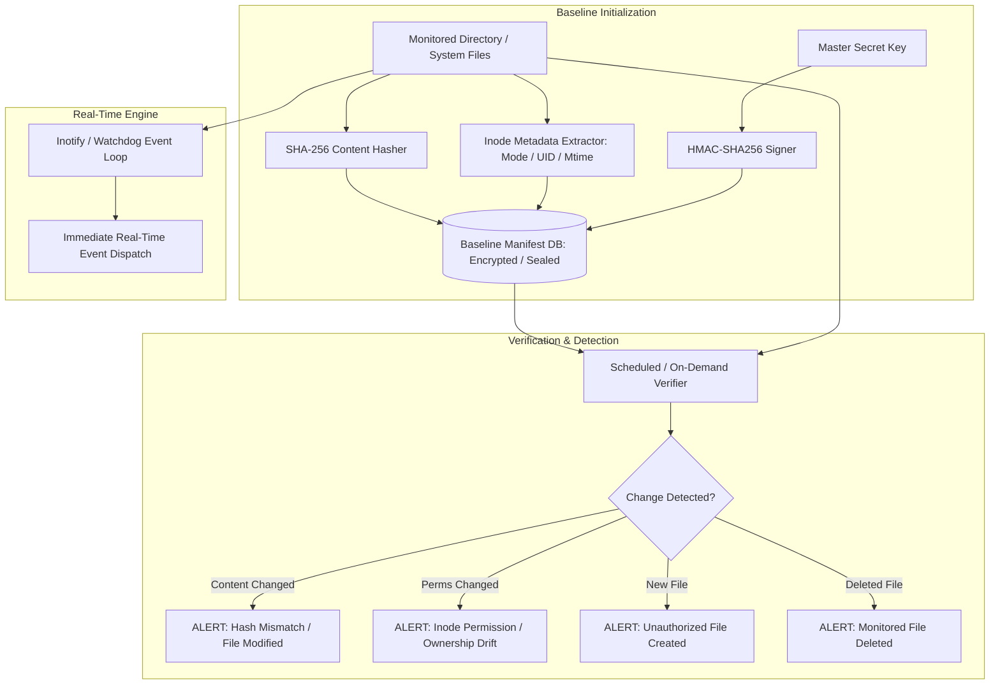

# File Integrity Monitoring (FIM) Engine (`fim`)

Production-Inspired Cryptographic File Integrity Monitoring (FIM) Engine with HMAC-SHA256 Baseline Sealing, Real-Time Inotify Watching, and Tamper Detection.

[](https://github.com/Krish9800/file-integrity-monitor/actions)
[](LICENSE)
[](https://www.python.org/)
[](https://typer.tiangolo.com/)
[](https://www.pcisecuritystandards.org/)

---

## Overview & Problem Statement

Adversaries routinely establish persistence, inject backdoors, or modify system binaries (e.g., `/bin/login`, `/etc/pam.d/`, `/etc/shadow`) following unauthorized access. Regulatory compliance frameworks (such as PCI DSS 11.5 and NIST SP 800-53) mandate automated File Integrity Monitoring to alert administrators immediately upon unauthorized file modifications.

**File Integrity Monitor (FIM)** is a robust, lightweight host security agent. It builds tamper-evident cryptographic baselines using SHA-256 and HMAC authentication, tracks file metadata (permissions, UID/GID, size, mtime), conducts scheduled verification audits, and monitors critical directory paths in real time via filesystem event hooks.

---

## Architecture & Data Flow



---

## Verified Features

- **Cryptographic Baseline Sealing:** Hashes files using SHA-256 and seals baseline manifests with HMAC-SHA256 to prevent attackers from tampering with the baseline database.
- **Full Inode Metadata Tracking:** Monitors file permissions (POSIX mode octals), owner UID, group GID, byte size, and last modified timestamp (`mtime`).
- **Deep Directory Recursion & Rule Filtering:** Supports regex and glob exclusion patterns (e.g. ignoring temporary logs, `.git`, or cache directories).
- **Real-Time Watch Mode:** Asynchronous real-time filesystem monitoring reporting creation, modification, and deletion events with millisecond precision.
- **Detailed Forensic Diff Reporting:** Generates structured terminal tables and JSON alerts detailing the exact nature of detected file drifts.

---

## Technology Stack

- **Runtime:** Python 3.12+
- **Cryptography:** Standard library `hashlib` & `hmac`
- **Filesystem Events:** `watchdog` & `pathlib`
- **CLI Framework:** Typer & Rich
- **Quality Gates:** Pytest, Ruff, Mypy Strict, Bandit

---

## Requirements & Installation

```bash
# Clone the repository
git clone https://github.com/Krish9800/file-integrity-monitor.git
cd file-integrity-monitor

# Create and activate virtual environment
python3 -m venv .venv
source .venv/bin/activate

# Install dependencies
pip install -e .
```

---

## Verified Usage Examples

### 1. Initialize Authentication Key

```bash
# Generate a cryptographic master key to seal baseline databases
fim init-key --output fim.key
```

### 2. Create Baseline Manifest

```bash
# Generate a signed baseline of a critical directory
fim baseline-create --directory /etc/nginx --key fim.key --output nginx_baseline.db
```

### 3. Verify System Against Baseline

```bash
# Perform an audit comparing disk state against the sealed baseline
fim verify --baseline nginx_baseline.db --key fim.key
```

Sample Detection Output:
```
[!] INTEGRITY VIOLATION DETECTED
  Path: /etc/nginx/nginx.conf
  Status: MODIFIED
  Expected SHA-256: 4a2b9f...
  Observed SHA-256: 9e8a1c...
  Expected Permissions: 0644 (rw-r--r--)
  Observed Permissions: 0777 (rwxrwxrwx)
```

### 4. Real-Time Watch Mode

```bash
# Actively watch a directory for instant modification events
fim watch --directory /var/www/html --key fim.key
```

---

## Testing & Quality Gates

```bash
# Run unit, integration, and security tests
pytest --cov=fim --cov-report=term-missing

# Test HMAC signature verification specifically
pytest tests/unit/test_baseline.py

# Code formatting and linting
ruff check .
ruff format --check .
mypy src/fim
```

---

## Security Model & Threat Boundaries

- **Tamper-Evident Baselines:** The baseline manifest is protected with HMAC-SHA256. If an adversary attempts to modify the baseline database on disk to hide a backdoor, verification fails immediately with a signature validation error.
- **Key Separation:** The cryptographic key (`fim.key`) should be stored on a read-only volume, secure vault, or external flash drive during live operations.
- **Memory-Safe Hashing:** Files are read in 64KB chunks to process multi-gigabyte ISOs and binaries without high memory overhead.

---

## Limitations & Known Issues

- **In-Memory Volatility:** In-memory file descriptors or deleted files that remain held open in Linux memory are detected as deleted from the filesystem, but memory inspection requires a memory forensics tool (e.g. Volatility).
- **Symlink Traversal:** By default, symbolic links are evaluated without following external targets to prevent directory traversal loops.

---

## License & Responsible Use

This project is licensed under the **MIT License** — see the [LICENSE](LICENSE) file for details.

> [!NOTE]
> Designed for system administrators, DevSecOps engineers, and compliance security audits.
